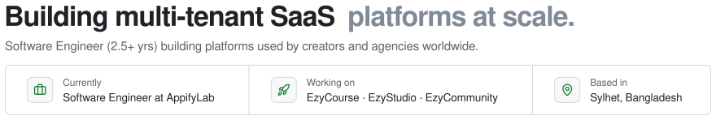
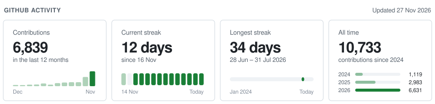
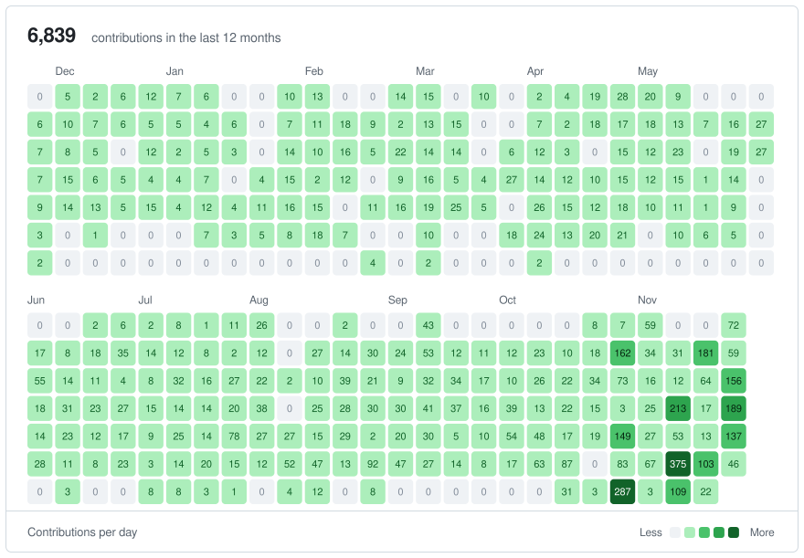
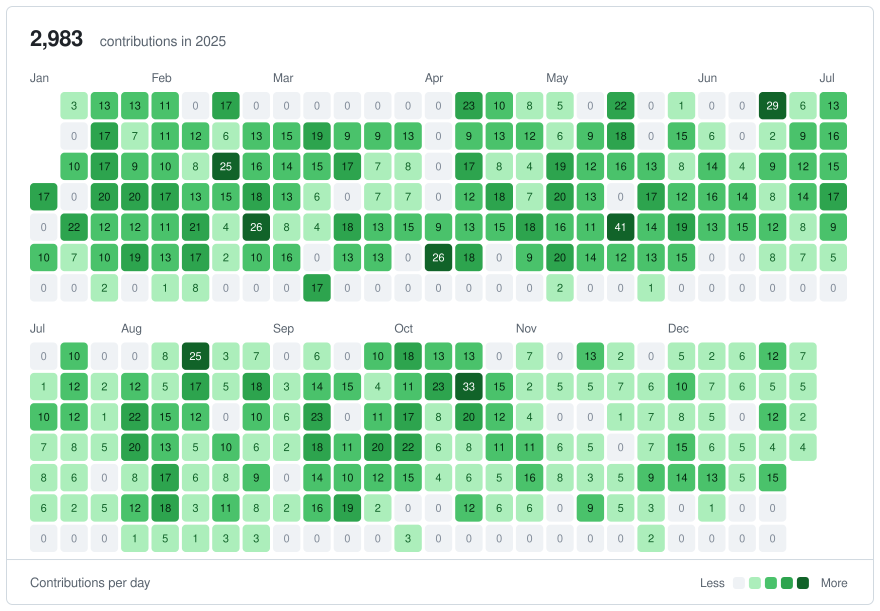
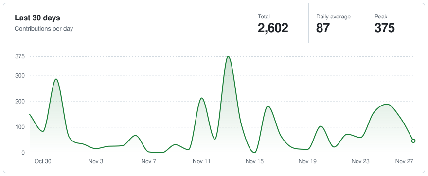

<!-- Generated by scripts/build.mjs. Edit the script, not this file: it is rebuilt every night. -->

<a href="https://nazmulnahid.bd"><picture><source media="(prefers-color-scheme: dark) and (max-width: 600px)" srcset="assets/brand-phone-dark.e16a3dd5.svg"><source media="(max-width: 600px)" srcset="assets/brand-phone-light.90866e57.svg"><source media="(prefers-color-scheme: dark)" srcset="assets/brand-dark.334d0738.svg"></picture></a><a href="https://nazmulnahid.bd"><picture><source media="(prefers-color-scheme: dark) and (max-width: 600px)" srcset="assets/badge-site-phone-dark.4ae367b3.svg"><source media="(max-width: 600px)" srcset="assets/badge-site-phone-light.5587652f.svg"><source media="(prefers-color-scheme: dark)" srcset="assets/badge-site-dark.12f0a560.svg"></picture></a><a href="https://www.linkedin.com/in/itsnazmulnahid/"><picture><source media="(prefers-color-scheme: dark) and (max-width: 600px)" srcset="assets/badge-li-phone-dark.bff728a0.svg"><source media="(max-width: 600px)" srcset="assets/badge-li-phone-light.14d1706c.svg"><source media="(prefers-color-scheme: dark)" srcset="assets/badge-li-dark.e7d5321a.svg"></picture></a><a href="mailto:hello@nazmulnahid.bd"><picture><source media="(prefers-color-scheme: dark) and (max-width: 600px)" srcset="assets/badge-mail-phone-dark.c8d11b07.svg"><source media="(max-width: 600px)" srcset="assets/badge-mail-phone-light.511035ae.svg"><source media="(prefers-color-scheme: dark)" srcset="assets/badge-mail-dark.e09a1db8.svg"></picture></a>
<picture><source media="(prefers-color-scheme: dark) and (max-width: 600px)" srcset="assets/hero-phone-dark.37c017b3.svg"><source media="(max-width: 600px)" srcset="assets/hero-phone-light.d360b802.svg"><source media="(prefers-color-scheme: dark)" srcset="assets/hero-dark.5060319f.svg"></picture>
<picture><source media="(prefers-color-scheme: dark) and (max-width: 600px)" srcset="assets/about-phone-dark.04881b09.svg"><source media="(max-width: 600px)" srcset="assets/about-phone-light.2b101d33.svg"><source media="(prefers-color-scheme: dark)" srcset="assets/about-dark.3ef0e568.svg"></picture>
 
<picture><source media="(prefers-color-scheme: dark) and (max-width: 600px)" srcset="assets/stack-phone-dark.fee671b1.svg"><source media="(max-width: 600px)" srcset="assets/stack-phone-light.70558467.svg"><source media="(prefers-color-scheme: dark)" srcset="assets/stack-dark.d6aaf960.svg"></picture>
 
<picture><source media="(prefers-color-scheme: dark) and (max-width: 600px)" srcset="assets/github-phone-dark.07337954.svg"><source media="(max-width: 600px)" srcset="assets/github-phone-light.4036b800.svg"><source media="(prefers-color-scheme: dark)" srcset="assets/github-dark.1e82acf3.svg"></picture>
 
<picture><source media="(prefers-color-scheme: dark) and (max-width: 600px)" srcset="assets/graph-6m-phone-dark.ccdef17d.svg"><source media="(max-width: 600px)" srcset="assets/graph-6m-phone-light.a98a2b49.svg"><source media="(prefers-color-scheme: dark)" srcset="assets/graph-6m-dark.96a2010c.svg"></picture>

Last 12 months: 6,839 contributions
<picture><source media="(prefers-color-scheme: dark) and (max-width: 600px)" srcset="assets/graph-12m-phone-dark.c4a52a52.svg"><source media="(max-width: 600px)" srcset="assets/graph-12m-phone-light.4447934f.svg"><source media="(prefers-color-scheme: dark)" srcset="assets/graph-12m-dark.65e0887b.svg"></picture>

2026: 6,631 contributions
<picture><source media="(prefers-color-scheme: dark) and (max-width: 600px)" srcset="assets/graph-2026-phone-dark.85089a86.svg"><source media="(max-width: 600px)" srcset="assets/graph-2026-phone-light.53d30ff1.svg"><source media="(prefers-color-scheme: dark)" srcset="assets/graph-2026-dark.08c7d159.svg"></picture>

2025: 2,983 contributions
<picture><source media="(prefers-color-scheme: dark) and (max-width: 600px)" srcset="assets/graph-2025-phone-dark.1c430e79.svg"><source media="(max-width: 600px)" srcset="assets/graph-2025-phone-light.4e393a92.svg"><source media="(prefers-color-scheme: dark)" srcset="assets/graph-2025-dark.dab5f602.svg"></picture>

2024: 1,119 contributions
<picture><source media="(prefers-color-scheme: dark) and (max-width: 600px)" srcset="assets/graph-2024-phone-dark.d816fa73.svg"><source media="(max-width: 600px)" srcset="assets/graph-2024-phone-light.0e68b93d.svg"><source media="(prefers-color-scheme: dark)" srcset="assets/graph-2024-dark.9cbaa169.svg"></picture>

<picture><source media="(prefers-color-scheme: dark) and (max-width: 600px)" srcset="assets/line-30d-phone-dark.e21e659e.svg"><source media="(max-width: 600px)" srcset="assets/line-30d-phone-light.aacbd2a7.svg"><source media="(prefers-color-scheme: dark)" srcset="assets/line-30d-dark.5d063783.svg"></picture>
 
Numbers redrawn every night by a GitHub Action.

