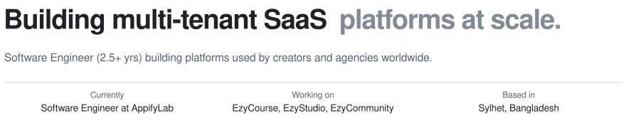
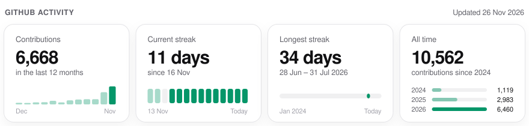
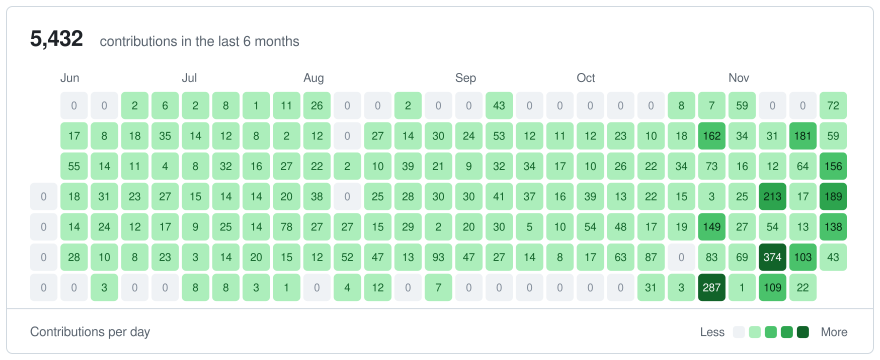
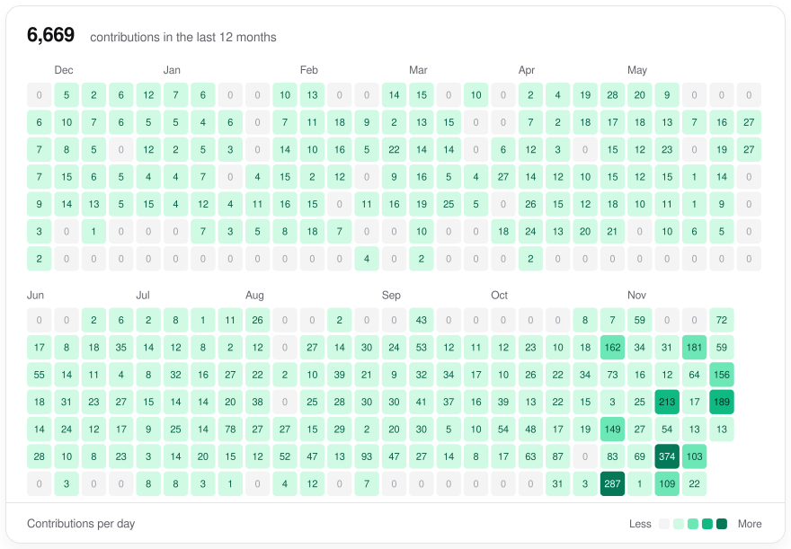
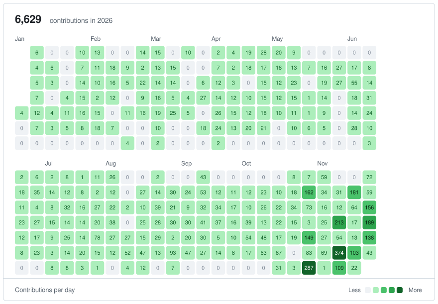
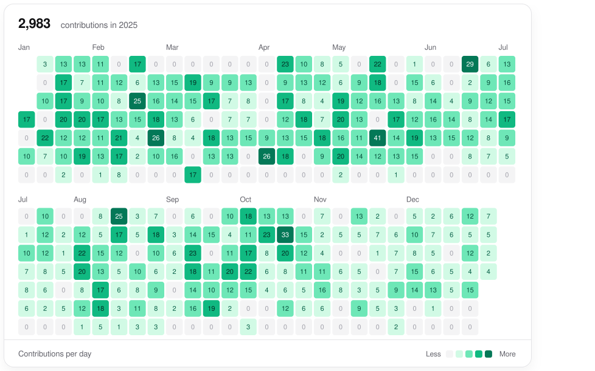
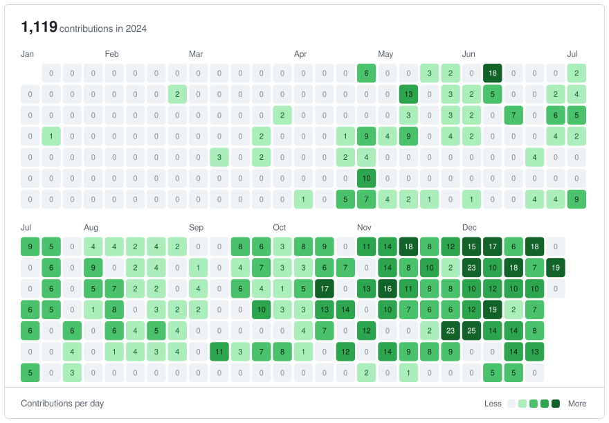
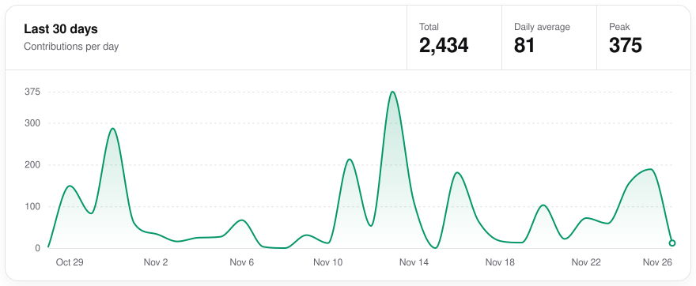

<!-- Generated by scripts/build.mjs. Edit the script, not this file: it is rebuilt every night. -->

<a href="https://nazmulnahid.bd"><picture><source media="(prefers-color-scheme: dark)" srcset="assets/brand-dark.svg"></picture></a>
 
<picture><source media="(prefers-color-scheme: dark) and (max-width: 600px)" srcset="assets/hero-phone-dark.svg"><source media="(max-width: 600px)" srcset="assets/hero-phone-light.svg"><source media="(prefers-color-scheme: dark)" srcset="assets/hero-dark.svg"></picture>

<a href="https://nazmulnahid.bd"><picture><source media="(max-width: 600px)" srcset="assets/none.svg"><source media="(prefers-color-scheme: dark)" srcset="assets/badge-site-dark.svg"></picture></a>
<a href="https://www.linkedin.com/in/itsnazmulnahid/"><picture><source media="(max-width: 600px)" srcset="assets/none.svg"><source media="(prefers-color-scheme: dark)" srcset="assets/badge-li-dark.svg"></picture></a>
<a href="mailto:hello@nazmulnahid.bd"><picture><source media="(max-width: 600px)" srcset="assets/none.svg"><source media="(prefers-color-scheme: dark)" srcset="assets/badge-mail-dark.svg"></picture></a>
 
<a href="https://nazmulnahid.bd"><picture><source media="(min-width: 601px)" srcset="assets/none.svg"><source media="(prefers-color-scheme: dark)" srcset="assets/badge-site-phone-dark.svg"></picture></a>
<a href="https://www.linkedin.com/in/itsnazmulnahid/"><picture><source media="(min-width: 601px)" srcset="assets/none.svg"><source media="(prefers-color-scheme: dark)" srcset="assets/badge-li-phone-dark.svg"></picture></a>
<a href="mailto:hello@nazmulnahid.bd"><picture><source media="(min-width: 601px)" srcset="assets/none.svg"><source media="(prefers-color-scheme: dark)" srcset="assets/badge-mail-phone-dark.svg"></picture></a>

<picture><source media="(prefers-color-scheme: dark) and (max-width: 600px)" srcset="assets/about-phone-dark.svg"><source media="(max-width: 600px)" srcset="assets/about-phone-light.svg"><source media="(prefers-color-scheme: dark)" srcset="assets/about-dark.svg"></picture>
 
<picture><source media="(prefers-color-scheme: dark) and (max-width: 600px)" srcset="assets/stack-phone-dark.svg"><source media="(max-width: 600px)" srcset="assets/stack-phone-light.svg"><source media="(prefers-color-scheme: dark)" srcset="assets/stack-dark.svg"></picture>
 
<picture><source media="(prefers-color-scheme: dark) and (max-width: 600px)" srcset="assets/github-phone-dark.svg"><source media="(max-width: 600px)" srcset="assets/github-phone-light.svg"><source media="(prefers-color-scheme: dark)" srcset="assets/github-dark.svg"></picture>
 
<picture><source media="(prefers-color-scheme: dark) and (max-width: 600px)" srcset="assets/graph-6m-phone-dark.svg"><source media="(max-width: 600px)" srcset="assets/graph-6m-phone-light.svg"><source media="(prefers-color-scheme: dark)" srcset="assets/graph-6m-dark.svg"></picture>

Last 12 months: 6,795 contributions
<picture><source media="(prefers-color-scheme: dark) and (max-width: 600px)" srcset="assets/graph-12m-phone-dark.svg"><source media="(max-width: 600px)" srcset="assets/graph-12m-phone-light.svg"><source media="(prefers-color-scheme: dark)" srcset="assets/graph-12m-dark.svg"></picture>

2026: 6,587 contributions
<picture><source media="(prefers-color-scheme: dark) and (max-width: 600px)" srcset="assets/graph-2026-phone-dark.svg"><source media="(max-width: 600px)" srcset="assets/graph-2026-phone-light.svg"><source media="(prefers-color-scheme: dark)" srcset="assets/graph-2026-dark.svg"></picture>

2025: 2,983 contributions
<picture><source media="(prefers-color-scheme: dark) and (max-width: 600px)" srcset="assets/graph-2025-phone-dark.svg"><source media="(max-width: 600px)" srcset="assets/graph-2025-phone-light.svg"><source media="(prefers-color-scheme: dark)" srcset="assets/graph-2025-dark.svg"></picture>

2024: 1,119 contributions
<picture><source media="(prefers-color-scheme: dark) and (max-width: 600px)" srcset="assets/graph-2024-phone-dark.svg"><source media="(max-width: 600px)" srcset="assets/graph-2024-phone-light.svg"><source media="(prefers-color-scheme: dark)" srcset="assets/graph-2024-dark.svg"></picture>

<picture><source media="(prefers-color-scheme: dark) and (max-width: 600px)" srcset="assets/line-30d-phone-dark.svg"><source media="(max-width: 600px)" srcset="assets/line-30d-phone-light.svg"><source media="(prefers-color-scheme: dark)" srcset="assets/line-30d-dark.svg"></picture>
 
Numbers redrawn every night by a GitHub Action.

